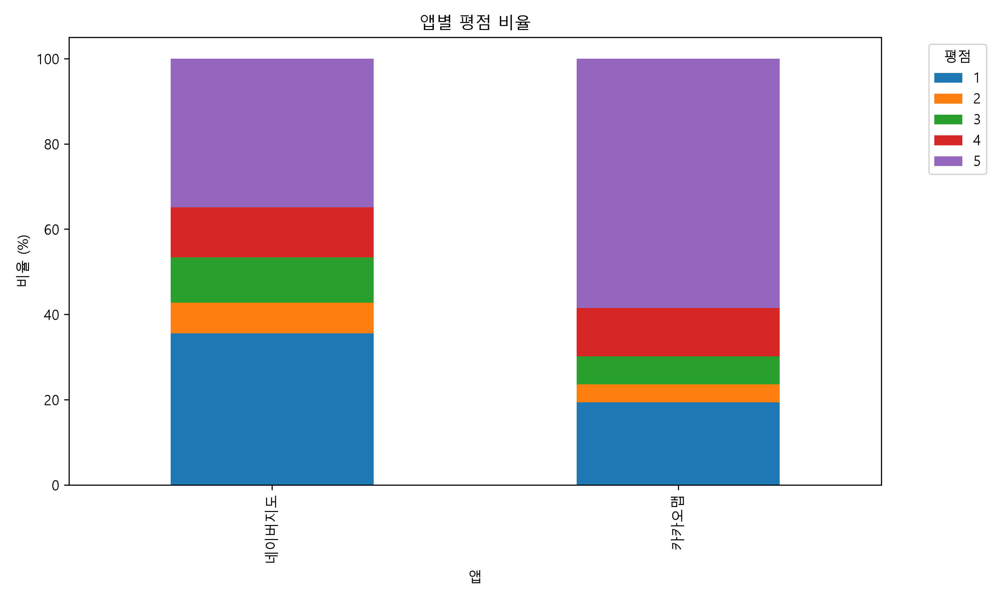
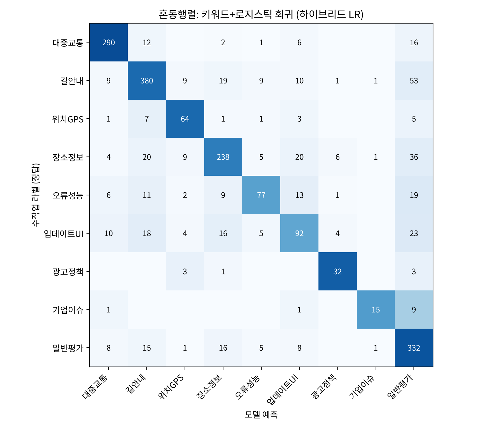
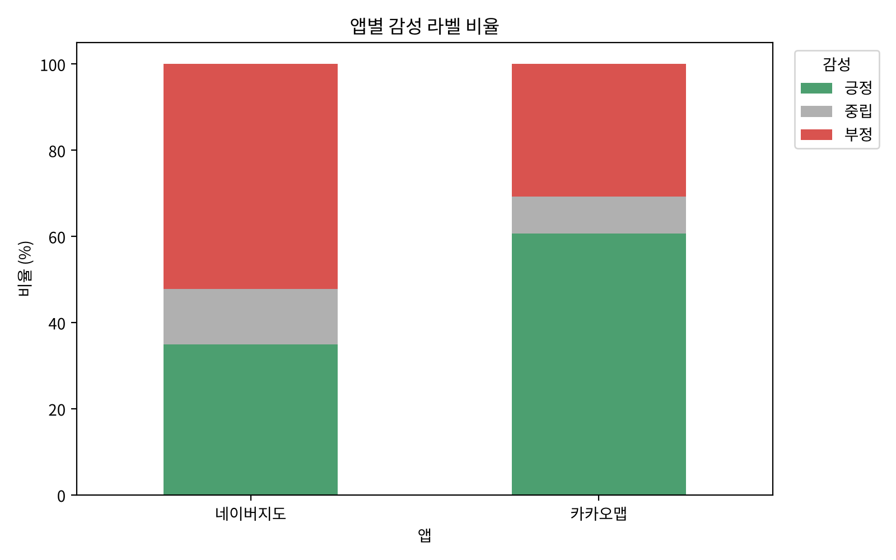
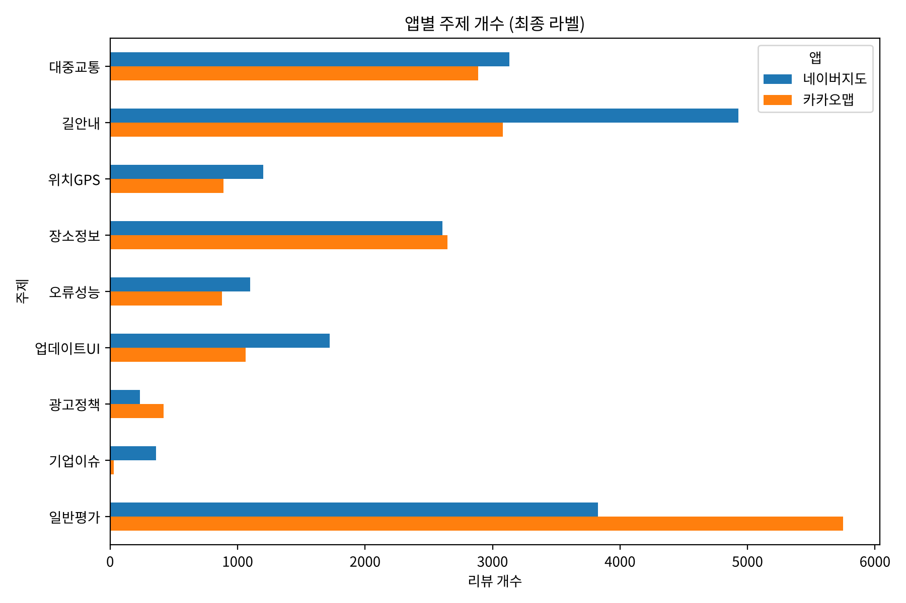
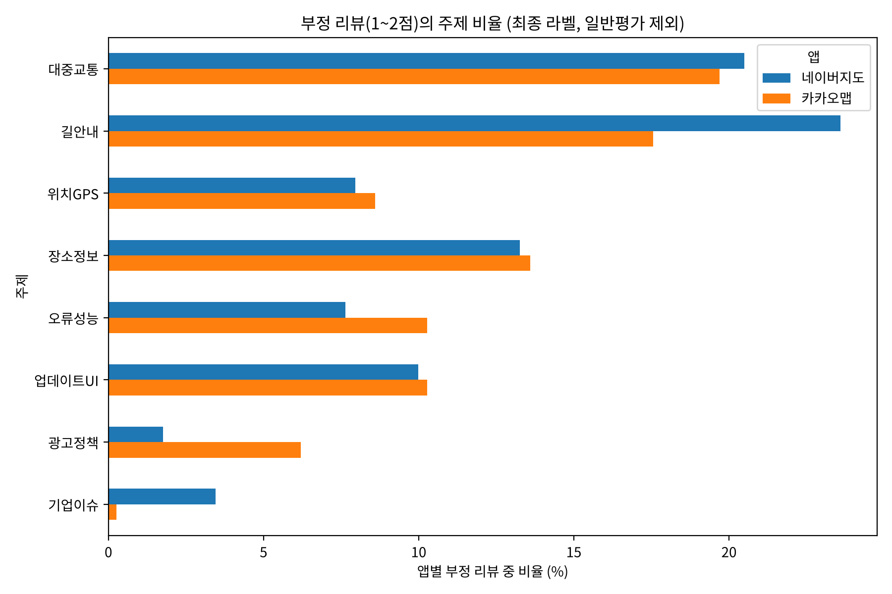
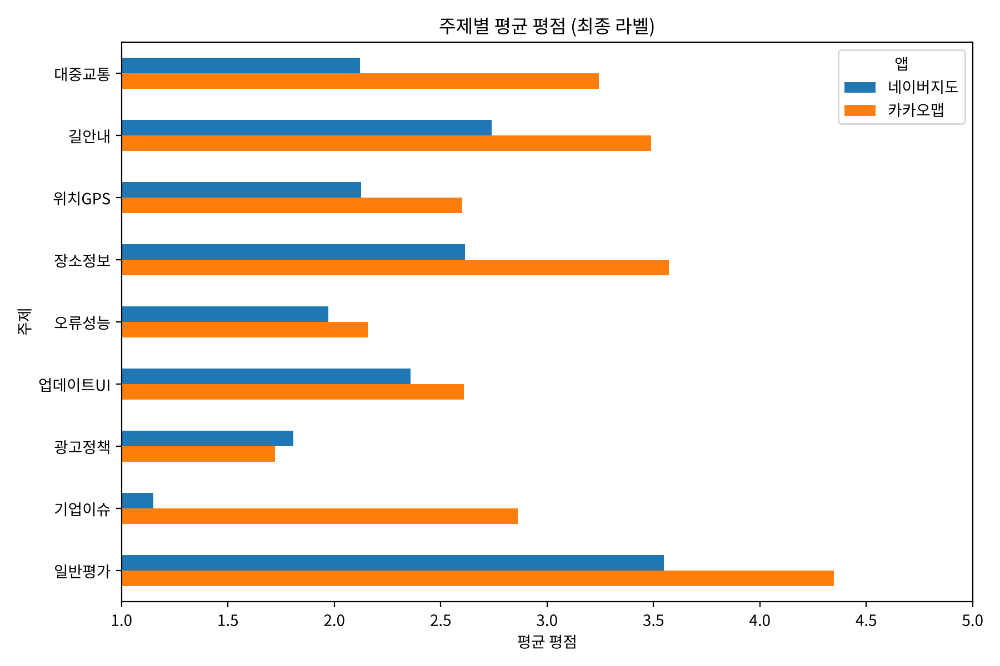

# 국내 지도 앱(카카오맵·네이버지도) 구글 플레이 리뷰 분석

## 1. 문제 정의 및 결론에 대한 가설

### 1.1 문제 정의

국내 지도·내비게이션 앱 시장은 카카오맵과 네이버지도가 양분하고 있다. 두 앱은 길찾기, 대중교통, 장소 검색 등 핵심 기능이 거의 같지만, 구글 플레이 스토어에서 수집한 리뷰의 평균 평점은 **카카오맵 3.85점, 네이버지도 3.03점으로 0.82점 차이**가 난다.

평점은 사용자의 만족도를 하나의 숫자로만 보여 주므로, 이 차이가 **어떤 기능에 대한 불만에서 비롯되었는지**는 알 수 없다. 본 분석은 리뷰 텍스트에 **감성**과 **주제** 라벨을 부여하여 다음 질문에 답하고자 한다.

> 두 지도 앱의 사용자는 각각 어떤 기능에 불만을 가지며, 그 차이가 평점 차이를 설명하는가?

### 1.2 가설

| 번호 | 가설 | 확인 방법 |
|---|---|---|
| H1 | 네이버지도는 카카오맵보다 부정 리뷰의 비율이 높을 것이다. | 앱별 감성 라벨 비율 |
| H2 | 네이버지도의 부정 리뷰는 **길안내(내비게이션)** 와 **업데이트·UI 변경**에 대한 불만의 비중이 카카오맵보다 클 것이다. | 부정 리뷰의 주제 라벨 비율 |
| H3 | **대중교통**(버스·지하철 도착 정보) 관련 불만은 두 앱 모두에서 가장 큰 불만 주제 중 하나일 것이다. | 부정 리뷰의 주제 라벨 비율 |
| H4 | 특정 시기의 평점 하락은 앱 기능이 아닌 외부 사건(기업 이슈 등)에 의해 발생할 수 있다. | 월별 리뷰 추이와 주제 라벨 |

---

## 2. 확보한 데이터의 양

| 항목 | 내용 |
|---|---|
| 수집 대상 | 카카오맵(`net.daum.android.map`), 네이버지도(`com.nhn.android.nmap`) |
| 수집 방법 | `google-play-scraper` 라이브러리, 한국 스토어·한국어 리뷰(`lang="ko", country="kr"`), 최신순 (`test1.py`) |
| 수집 기간 | 2018년 10월 ~ 2025년 12월 |
| 원본 데이터 | **50,000건** (앱별 25,000건) |
| 전처리 후 데이터 | **36,750건** (네이버지도 19,106건, 카카오맵 17,644건) |
| 수작업 라벨 데이터 | **2,000건** (앱별 1,000건) |
| 수집 항목 | 앱 이름, 리뷰 ID, 평점(1~5), 작성일, 리뷰 내용, 좋아요 수, 앱 버전 |

처음에는 2024~2025년 리뷰만 사용하려 하였으나, 이 기간의 리뷰는 9,659건으로 권장 기준(전처리 후 25,000건 이상)에 미치지 못하였다. 따라서 수집 기간을 2018년부터로 넓혀 앱별 25,000건을 확보하였다.

> 원본 파일명(`map_app_reviews_2024_2025_50000.csv`)에는 2024_2025가 남아 있으나, 실제 데이터 기간은 위 표와 같다.

### 2.1 전처리

| 단계 | 기준 | 남은 리뷰 수 |
|---|---|---|
| 원본 | - | 50,000 |
| 중복 제거 | `review_id` 기준 | 50,000 |
| 언어 필터 | 글자 중 한글 비율 50% 이상 (영어만·이모지만 있는 리뷰 제외) | 49,321 |
| 길이 필터 | 공백 정리 후 10글자 이상 ("좋아요", "굿" 등 주제를 판단할 수 없는 리뷰 제외) | **36,750** |

---

## 3. 원본 데이터 EDA

원본 50,000건에 대한 탐색적 분석은 `test.py`로 수행하였으며, 그래프 13개는 `eda_results/` 폴더에 있다.

### 3.1 기본 통계

| 앱 | 리뷰 수 | 평균 평점 | 평균 리뷰 길이 | 리뷰 길이 중앙값 | 평균 좋아요 수 |
|---|---|---|---|---|---|
| 네이버지도 | 25,000 | **3.03** | 55.3자 | 33자 | 2.97 |
| 카카오맵 | 25,000 | **3.85** | 39.2자 | 19자 | 2.36 |

- 결측치는 `app_version` 4,579건(앱 버전 정보가 없는 리뷰)뿐이며, 분석에 쓰는 평점과 리뷰 내용에는 결측이 없다.

### 3.2 평점 분포

| 앱 | 1점 | 2점 | 3점 | 4점 | 5점 |
|---|---|---|---|---|---|
| 네이버지도 | 35.6% | 7.2% | 10.6% | 11.7% | 34.9% |
| 카카오맵 | 19.4% | 4.2% | 6.6% | 11.4% | 58.5% |



- 두 앱 모두 1점과 5점에 몰린 **양극화(J자형) 분포**를 보인다. 앱 리뷰는 매우 만족하거나 매우 불만족한 사용자가 주로 작성하기 때문이다.
- 네이버지도는 1점 비율(35.6%)이 5점 비율(34.9%)보다 높고, 카카오맵은 5점이 절반 이상(58.5%)이다.

### 3.3 리뷰 길이

| 평점 | 1점 | 2점 | 3점 | 4점 | 5점 |
|---|---|---|---|---|---|
| 평균 리뷰 길이 | 65.7자 | 79.5자 | 74.7자 | 55.3자 | 25.4자 |


- 5점 리뷰는 평균 25자로 짧고("좋아요", "잘 쓰고 있어요"), 1~3점 리뷰는 65~80자로 구체적인 불만을 길게 서술한다.
- 즉 **기능별 불만을 파악하는 데 필요한 정보는 대부분 낮은 평점의 리뷰에 들어 있다.** 본 분석에서 부정 리뷰의 주제 분석에 초점을 맞춘 이유이다.

### 3.4 시기별 리뷰 추이


- 2019년에 리뷰가 가장 많고(앱별 약 5,800건), 2020년 이후는 앱별 연간 2,100~4,600건 수준이다.
- 네이버지도는 **2021년 5월에 리뷰가 782건으로, 월 중앙값(238건)의 약 3배로 급증**하였다. 5절의 주제 라벨링 결과, 이 달 리뷰(전처리 후 649건) 중 289건(44.5%)이 앱 기능이 아니라 회사 직원의 직장 내 괴롭힘 사건에 대한 항의·추모 리뷰였다(가설 H4).

---

## 4. 데이터 라벨링의 정의

리뷰마다 두 종류의 라벨을 부여한다. 최종 학습 데이터셋은 `dataset/labeled_reviews_final.csv`이다.

### 4.1 라벨 1: 감성 (`sentiment`)

| 라벨 | 정의 |
|---|---|
| 긍정 | 평점 4~5점 |
| 중립 | 평점 3점 |
| 부정 | 평점 1~2점 |

리뷰 작성자가 직접 매긴 평점은 그 리뷰에 대한 작성자 본인의 평가이므로, 대량의 리뷰에 감성 라벨을 부여하는 신뢰할 수 있는 기준(약한 지도, weak supervision)으로 사용하였다.

### 4.2 라벨 2: 주제 (`topic`)

리뷰가 **앱의 어떤 기능이나 측면에 대해 말하는지**를 나타내는 라벨이다. 리뷰 하나에 여러 주제가 나올 수 있으므로, 가장 중심이 되는 주제 하나를 대표 주제(`topic`)로, 언급된 주제 전체를 보조 정보(`topic_all`)로 저장한다.

| 주제 | 정의 | 예시 리뷰 |
|---|---|---|
| 대중교통 | 버스·지하철 도착 정보, 노선, 환승, 승하차 알림 | "버스 시간 하나도 안 맞음" |
| 길안내 | 자동차·도보·자전거 경로 안내와 내비게이션 기능 | "멀쩡한 길 두고 이상한 길로 안내함" |
| 위치GPS | 현재 위치, GPS 수신, 방향 인식 | "터널에서 GPS가 끊어져요" |
| 장소정보 | 장소 검색, 가게 정보, 즐겨찾기, 로드뷰, 지도 데이터 갱신 | "폐업한 식당이 아직도 나와요" |
| 오류성능 | 앱 꺼짐, 먹통, 느림, 네트워크 오류 등 앱 자체의 문제 | "앱이 계속 강제 종료됨" |
| 업데이트UI | 업데이트 후 바뀐 화면·디자인·조작 방식 | "업데이트 이후 너무 불편해졌어요" |
| 광고정책 | 광고, 로그인, 개인정보, 권한 요구 | "앱 실행할 때마다 광고가 떠요" |
| 기업이슈 | 앱 기능과 무관한 회사 관련 사건에 대한 의견 | "삼가 고인의 명복을 빕니다" |
| 일반평가 | 특정 기능 언급 없이 전반적인 만족·불만만 표현 | "잘 쓰고 있습니다", "최고에요" |

주제는 3절의 EDA에서 부정 리뷰에 자주 등장한 단어(버스, 업데이트, 길찾기, 지하철, 위치, 오류, 즐겨찾기 등)와 지도 앱의 기능 구성을 바탕으로 정하였다.

---

## 5. 데이터 라벨링 수행 과정

```
원본 50,000건 ─▶ 전처리 36,750건
                   │
                   ├─▶ ① 감성 라벨: 평점 규칙 (36,750건)
                   │
                   └─▶ ② 주제 라벨
                         (1) 키워드 사전으로 1차 자동 라벨링
                         (2) 2,000건 수작업 라벨링 (개발용 300 + 평가용 200 + 추가 1,500)
                         (3) 수작업 2,000건으로 분류 모델 학습·비교
                         (4) 최종 모델로 나머지 34,750건 라벨링 ─▶ 최종 학습 데이터셋
```

### 5.1 감성 라벨링

4.1절의 규칙에 따라 평점을 감성 라벨로 바꾸었다(`labeling.py`).

### 5.2 주제 라벨링 (1): 키워드 사전으로 1차 자동 라벨링

1. **키워드 사전 구성**: 주제마다 그 주제를 나타내는 단어 목록을 만들었다(`topic_keywords.py`). 예를 들어 대중교통은 "버스", "지하철", "정류장", "환승", "승하차" 등이다.
2. **점수 계산**: 리뷰를 소문자로 바꾼 뒤, 주제별로 키워드가 몇 번 나오는지 센다. "대중교통", "GPS", "광고"처럼 주제가 분명한 단어는 3점, 나머지 단어는 1점으로 계산한다.
3. **대표 주제 결정**: 점수가 가장 높은 주제를 대표 주제로 정한다. 점수가 같으면 사전의 앞쪽 주제를 우선하고, 키워드가 하나도 없으면 "일반평가"로 분류한다.

### 5.3 주제 라벨링 (2): 수작업 라벨링 2,000건

키워드 규칙이 맞는지 확인하고 분류 모델의 학습 데이터로 쓰기 위해, 리뷰를 하나씩 읽고 주제를 판단하는 수작업 라벨링을 **2,000건**(앱별 1,000건) 수행하였다. 라벨링은 AI(Claude)를 라벨러로 활용하였으며, 모든 라벨러가 같은 **라벨링 가이드**(4.2절 정의 + 아래 판단 규칙)를 따랐다.

| 판단 규칙 | 예시 |
|---|---|
| 여러 주제가 섞이면 리뷰어가 가장 강조하는 문제를 고른다 | - |
| 특정 기능의 결과가 틀리거나 안 나오면 그 기능의 주제 | "대중교통 검색이 안 떠요" → 대중교통 |
| 기능을 특정하지 않은 고장·느림은 오류성능 | "앱이 계속 튕겨요" → 오류성능 |
| 지도·장소 데이터가 오래되었다는 "업데이트 요청"은 장소정보 | "지도 업데이트 좀 해주세요" → 장소정보 |
| 길을 잘/못 알려준다는 짧은 평가도 길안내 | "길 잘 찾아줘서 좋아요" → 길안내 |
| 기능 요청도 해당 기능의 주제 | "즐겨찾기 개수 늘려주세요" → 장소정보 |

| 묶음 | 건수 | 용도 |
|---|---|---|
| 개발용 | 300 | 키워드 사전의 오분류를 보고 사전 보완 |
| 평가용 | 200 | 사전 보완 후 키워드 규칙의 정확도 측정, 라벨러 간 일치도 측정 |
| 추가 | 1,500 | 분류 모델 학습 데이터 확충 |

**키워드 사전 보완 (개발용 300건)**

1차 키워드 사전의 정확도는 **82.0%** 였다. 틀린 사례를 분석하여 다음과 같이 사전을 보완하였다.

| 오분류 유형 | 예시 | 보완 내용 |
|---|---|---|
| 키워드가 없어 일반평가로 분류 | "터널에서 전혀 못 잡네" | 위치GPS에 "터널", "지피에스" 추가 |
| 다른 뜻으로 쓰인 단어 | "승차 **알림**" → 광고정책, "**카카오톡**이 낫다" → 광고정책 | 광고정책에서 "알림", "카카오톡" 제거, 대중교통에 "승하차" 추가 |
| 단어 일부가 겹침 | "전**기차** 충전소" → 대중교통(기차) | "기차" 제거 |
| 지도 데이터 갱신을 앱 업데이트로 분류 | "**지도 업데이트** 좀 해주세요" | 장소정보에 "지도 업데이트"를 강한 키워드로 추가 |
| 회사 이슈 표현 누락 | "사람 죽여 놓고 서비스가 잘 되길 바람?" | 기업이슈에 "죽여", "죽음" 추가 |

보완 후 같은 300건의 정확도는 92.7%로 올랐지만, 사전을 고칠 때 참고한 데이터로 잰 값이라 실제 성능보다 높다. 사전 보완에 쓰지 않은 평가용 200건에서는 **71.0%** 였다.

**라벨 품질 확인 (라벨러 간 일치도)**

평가용 200건은 서로 다른 두 라벨러가 상대의 결과를 모르는 상태에서 각각 라벨링하였다(`dataset/label_agreement.csv`).

| 지표 | 값 | 해석 |
|---|---|---|
| 일치율 | **90.0%** | 200건 중 180건의 주제가 같음 |
| Cohen's kappa | **0.879** | 우연히 일치할 확률을 보정한 일치도. 0.8 이상은 "거의 완벽한 일치"로 해석 |

일치하지 않은 20건은 대부분 "거리뷰가 맨날 느려요"(오류성능 ↔ 장소정보), "업데이트되고 저장한 곳이 안 보여요"(업데이트UI ↔ 장소정보)처럼 두 주제가 함께 나타나는 리뷰였다. 9개 주제 정의와 가이드가 라벨러에 관계없이 일관된 라벨을 만들 만큼 명확하다고 판단하여, 2,000건을 정답 데이터로 사용하였다.

**감성 라벨 확인**

평가용 200건에는 리뷰 내용으로 판단한 감성도 함께 붙여 평점 기반 감성 라벨과 비교하였다.

| 항목 | 정확도 |
|---|---|
| 감성 라벨 (3분류) | 74.5% |
| 감성 라벨 (긍정·부정만) | **88.5%** |

긍정 리뷰가 부정으로 분류된 경우는 없었고, 내용은 불만인데 4~5점을 준 리뷰가 10건 있었다. 중립 정확도가 낮은 이유는 "다크모드 부탁드려요"처럼 **기능을 요청하면서 5점을 준 리뷰**가 많기 때문이다. 긍정과 부정만 놓고 보면 88.5%가 일치하여, 평점을 감성 라벨로 쓰는 것은 타당하다고 판단하였다.

### 5.4 주제 라벨링 (3): 수작업 2,000건으로 분류 모델 학습

수작업 라벨 2,000건을 정답으로 하여, 리뷰 텍스트를 입력하면 주제를 예측하는 분류 모델을 학습하였다(`topic_model.py`).

**입력 피처**

- **TF-IDF 문자 n-gram(2~4글자) + 단어 n-gram(1~2단어)**: 한국어는 "버스가", "버스는"처럼 조사가 붙어 형태가 다양하므로, 형태소 분석기 없이도 잘 동작하는 문자 단위 조각을 함께 사용하였다.
- **키워드 피처(하이브리드 모델만)**: 5.2절 키워드 사전의 주제별 점수 9개와 규칙이 고른 대표 주제 9개(one-hot)를 TF-IDF에 덧붙였다.

**5-fold 교차검증 결과** (층화 추출, 수작업 라벨 2,000건)

| 모델 | 정확도 | Macro F1 | 정확도 (개발용 제외 1,700건) |
|---|---|---|---|
| 키워드 규칙 (기준) | 0.742 | 0.710 | 0.709 |
| 나이브 베이즈 (TF-IDF) | 0.704 | 0.658 | 0.706 |
| 로지스틱 회귀 (TF-IDF) | 0.696 | 0.656 | 0.701 |
| 선형 SVM (TF-IDF) | 0.707 | 0.670 | 0.712 |
| **키워드 + 로지스틱 회귀 (하이브리드)** | **0.760** | **0.730** | **0.737** |
| 키워드 + 선형 SVM (하이브리드) | 0.756 | 0.719 | 0.731 |


- 키워드 규칙은 개발용 300건을 보고 다듬었으므로, 공정한 비교를 위해 **개발용을 뺀 1,700건 정확도**를 함께 보았다. 이 기준에서 규칙은 70.9%이다.
- TF-IDF만 쓴 모델(70~71%)은 키워드 규칙과 비슷하였다. 2,000건은 텍스트만으로 9개 주제를 학습하기에 넉넉하지 않은 양이기 때문이다.
- 키워드 피처를 더한 **하이브리드 로지스틱 회귀**가 모든 지표에서 가장 좋아(정확도 76.0%, Macro F1 0.730) 최종 모델로 선정하였다. 직접 정리한 키워드 지식과 데이터에서 학습한 표현이 서로를 보완한 결과이다.
- 수작업 라벨러 간 일치도가 90%이므로, 이 데이터에서 기대할 수 있는 정확도의 상한은 약 90%로 볼 수 있다.

**주제별 F1 (키워드 규칙 → 최종 모델)**

| 주제 | 건수 | 키워드 규칙 | 최종 모델 |
|---|---|---|---|
| 대중교통 | 327 | 0.878 | 0.884 |
| 길안내 | 491 | 0.788 | 0.797 |
| 위치GPS | 82 | 0.703 | 0.736 |
| 장소정보 | 339 | 0.729 | 0.743 |
| 오류성능 | 138 | 0.564 | **0.639** |
| 업데이트UI | 172 | 0.548 | 0.566 |
| 광고정책 | 39 | 0.725 | 0.771 |
| 기업이슈 | 26 | 0.732 | 0.682 |
| 일반평가 | 386 | 0.726 | 0.753 |



대중교통·길안내처럼 표현이 분명한 주제는 F1이 0.8 이상으로 높고, 업데이트UI·오류성능은 "업데이트 이후 앱이 멈춤"처럼 다른 주제와 함께 나오는 경우가 많아 상대적으로 낮다.

### 5.5 주제 라벨링 (4): 최종 라벨 부여

최종 모델(하이브리드 로지스틱 회귀)을 수작업 2,000건 전체로 다시 학습한 뒤, 나머지 34,750건의 주제를 예측하였다. 수작업 라벨이 있는 2,000건은 수작업 라벨을 그대로 사용하였다. 최종 라벨은 키워드 규칙 라벨과 92.1%가 같고, 나머지 7.9%가 모델에 의해 수정되었다.

---

## 6. 라벨링 결과: 학습 데이터셋 구축

### 6.1 데이터셋 구성

| 파일 | 건수 | 내용 |
|---|---|---|
| `dataset/labeled_reviews_final.csv` | **36,750** | **최종 학습 데이터셋**: 전처리한 전체 리뷰 + 감성·주제 라벨 |
| `dataset/gold_2000.csv` | **2,000** | 수작업 주제 라벨 통합본 (분류 모델 학습 데이터) |
| `dataset/label_dev_gold.csv` | 300 | 수작업 라벨 (개발용) |
| `dataset/label_test_gold.csv` | 200 | 수작업 라벨 (평가용, 감성 정답 포함) |
| `dataset/label_extra_gold.csv` | 1,500 | 수작업 라벨 (추가) |
| `dataset/label_agreement.csv` | 200 | 라벨러 간 일치도 확인용 |
| `dataset/labeled_reviews.csv` | 36,750 | 중간 결과: 키워드 규칙 라벨 |
| `dataset/model_results.csv` | - | 모델별 교차검증 결과 |

`labeled_reviews_final.csv`의 열 구성은 다음과 같다.

| 열 | 설명 |
|---|---|
| `app_name`, `review_id`, `review_date`, `rating`, `review_text` | 원본 정보 |
| `review_length`, `thumbs_up_count`, `app_version` | 리뷰 길이, 좋아요 수, 앱 버전 |
| `sentiment` | 감성 라벨 (긍정·중립·부정) |
| `topic` | **최종 주제 라벨** (9개 중 1개) |
| `topic_source` | 주제 라벨의 출처 (수작업 2,000건 / 모델 34,750건) |
| `topic_rule` | 키워드 규칙 라벨 (비교용) |
| `topic_all` | 키워드 기준으로 언급된 모든 주제 (`|`로 구분) |

### 6.2 분류 모델의 학습 데이터 (수작업 라벨 2,000건)

5.4절 분류 모델은 `dataset/gold_2000.csv`로 학습하였다. 리뷰 텍스트(`review_text`)가 입력, 수작업 주제 라벨(`gold_topic`)이 정답이다.

| 열 | 설명 |
|---|---|
| `review_id` | 리뷰 ID (`labeled_reviews_final.csv`와 연결) |
| `app_name`, `rating`, `review_text` | 앱 이름, 평점, 리뷰 내용 (**입력**) |
| `gold_topic` | 리뷰를 직접 읽고 붙인 주제 라벨 (**정답**) |
| `gold_set` | 라벨링 묶음 (개발용 300 / 평가용 200 / 추가 1,500) |
| `rule_topic` | 같은 리뷰의 키워드 규칙 라벨 (비교용) |

**주제별 건수**

| 주제 | 네이버지도 | 카카오맵 | 합계 |
|---|---|---|---|
| 길안내 | 289 | 202 | 491 |
| 일반평가 | 120 | 266 | 386 |
| 장소정보 | 153 | 186 | 339 |
| 대중교통 | 174 | 153 | 327 |
| 업데이트UI | 114 | 58 | 172 |
| 오류성능 | 72 | 66 | 138 |
| 위치GPS | 45 | 37 | 82 |
| 광고정책 | 12 | 27 | 39 |
| 기업이슈 | 21 | 5 | 26 |
| **합계** | **1,000** | **1,000** | **2,000** |

광고정책(39건)과 기업이슈(26건)는 건수가 적어, 학습할 때 `class_weight="balanced"`로 적은 주제에 가중치를 더 주었다.

**학습 데이터 예시**

| 리뷰 내용 (입력) | 앱 | 평점 | 주제 (정답) |
|---|---|---|---|
| 어느순간부터 대중교통 길찾기가 아얘 안뜨는데 그럼 뭘 보고 이용하라는 것인가요 | 네이버지도 | 1 | 대중교통 |
| 버스정류장 위젯설정시 버스도착시간이 안나오고 nullnull로 표시됩니다.. 무슨문제죠? | 네이버지도 | 3 | 대중교통 |
| 앱에서 15분 거리라고해서 왓는데 1시간 15분째 가는중 | 네이버지도 | 1 | 길안내 |
| 자전거 길찾기에 경사도 표시되어 있는게 너무 맘에 들어요 | 카카오맵 | 5 | 길안내 |
| 앱 실행후 내 위치가 타 도시로 나오는데 어떻게 해결하나요 | 네이버지도 | 1 | 위치GPS |
| 방향표시 개선좀해주세요. 8자로 폰 움직여도 나침반 방향 잡지도 못하는데 지도가 무슨 의미가 있어요 | 카카오맵 | 2 | 위치GPS |
| 맛집 검색할때 자주 쓰는데 네이버처럼 광고 리뷰기 없어서 객관적인거 같아요 | 카카오맵 | 5 | 장소정보 |
| 폴더안에 폴더 기능 추가 부탁드립니다 | 카카오맵 | 5 | 장소정보 |
| 평소엔 접속이 잘됬는데 오늘은 접속하면 계속 팅기네요. 개선좀 해줘요. | 카카오맵 | 4 | 오류성능 |
| 며칠전부터 먹통입니다. 지하철 노선을 이용하려해도 넘어가지질 않고 지도만 나오고 아무것도 안되네요 | 네이버지도 | 1 | 오류성능 |
| 이번에 업그레이드되면서 경유지 버튼이 사라졌는데 다시 복구해주세요 너무나 불편합니다 | 네이버지도 | 3 | 업데이트UI |
| 지도 확대랑 축소 기능 +/-로 하던게 편했는데 부활해주세요 ㅠ | 네이버지도 | 3 | 업데이트UI |
| 광고 좀 없애주세요 제발 이젠 검색창까지 광고 넣나요? | 카카오맵 | 2 | 광고정책 |
| 다좋은데 자꾸 위치정보 키라고 화면 바꿀때마다 나와서 취소 자꾸 눌러 줘야하는게 귀찮음 | 카카오맵 | 3 | 광고정책 |
| 아랫 사람 괴롭혀서 자살하게 만드는 서비스가 이건가요??? | 네이버지도 | 1 | 기업이슈 |
| 카카오맵으로 이사갑니다. 더이상 네이버지도는 쓸일이 없을겁니다. 삼가 고인의명복을 빕니다. | 네이버지도 | 1 | 기업이슈 |
| 좋네요 딱히 설명할필요없이 아~주 좋아요 앞으로도 쭉 함께할께요..♡ | 카카오맵 | 5 | 일반평가 |
| 다 좋아요 ! 이 형태로 계속 유지 했으면 좋겠어요. | 카카오맵 | 5 | 일반평가 |

위 예시처럼 리뷰 내용과 평점이 항상 같은 방향은 아니다. "며칠전부터 먹통입니다"는 1점이지만, "평소엔 접속이 잘됐는데 오늘은 계속 팅기네요"는 불만인데도 4점이다. 주제 라벨은 평점과 관계없이 **리뷰가 무엇에 대해 말하는지**만 보고 붙였다.

### 6.3 라벨 분포

**감성 라벨**

| 앱 | 긍정 | 중립 | 부정 |
|---|---|---|---|
| 네이버지도 | 6,680 (35.0%) | 2,445 (12.8%) | **9,981 (52.2%)** |
| 카카오맵 | 10,702 (60.7%) | 1,514 (8.6%) | 5,428 (30.8%) |



**주제 라벨 (최종)**

| 주제 | 네이버지도 | 카카오맵 | 합계 |
|---|---|---|---|
| 길안내 | 4,928 | 3,080 | 8,008 |
| 대중교통 | 3,132 | 2,887 | 6,019 |
| 장소정보 | 2,607 | 2,648 | 5,255 |
| 업데이트UI | 1,721 | 1,062 | 2,783 |
| 위치GPS | 1,200 | 888 | 2,088 |
| 오류성능 | 1,099 | 879 | 1,978 |
| 광고정책 | 233 | 421 | 654 |
| 기업이슈 | 359 | 29 | 388 |
| 일반평가 | 3,827 | 5,750 | 9,577 |
| **합계** | **19,106** | **17,644** | **36,750** |



특정 기능을 언급한 리뷰는 27,173건(73.9%)이다.

---

## 7. 라벨링 결과로 본 가설 확인

### 7.1 부정 리뷰의 주제 비율 (최종 라벨)

| 주제 | 네이버지도 | 카카오맵 |
|---|---|---|
| 길안내 | **23.6%** | 17.6% |
| 대중교통 | **20.5%** | **19.7%** |
| 장소정보 | 13.3% | 13.6% |
| 업데이트UI | 10.0% | 10.3% |
| 오류성능 | 7.6% | 10.3% |
| 위치GPS | 8.0% | 8.6% |
| 광고정책 | 1.8% | 6.2% |
| 기업이슈 | 3.5% | 0.3% |
| 일반평가 | 11.8% | 13.5% |





### 7.2 가설별 결과

| 가설 | 결과 | 근거 |
|---|---|---|
| H1 부정 리뷰 비율 | **지지** | 부정 리뷰 비율이 네이버지도 52.2%, 카카오맵 30.8%로 21.4%p 차이 |
| H2 길안내·업데이트UI 불만 | **부분 지지** | 길안내는 네이버지도(23.6%)가 카카오맵(17.6%)보다 6.0%p 높음. 업데이트UI는 두 앱이 비슷함(10.0% vs 10.3%) |
| H3 대중교통 공통 불만 | **지지** | 두 앱 모두 부정 리뷰의 약 20%로 길안내와 함께 가장 큰 불만 주제 |
| H4 외부 사건의 영향 | **지지** | 네이버지도 기업이슈 리뷰 359건 중 289건(80.5%)이 2021년 5월에 집중, 평균 평점 1.15점 |

- 같은 주제라도 네이버지도의 평균 평점이 거의 모든 주제에서 낮았다. 특히 **대중교통(2.12점 vs 3.24점)과 장소정보(2.62점 vs 3.57점), 길안내(2.74점 vs 3.49점)** 에서 차이가 컸다. 두 앱의 평점 차이는 사용자가 가장 많이 쓰는 길찾기·대중교통·장소 검색 기능의 만족도 차이에서 주로 나온 것으로 해석된다.
- 카카오맵은 광고정책 불만(6.2%)이 네이버지도(1.8%)보다 많았다. 해당 리뷰 337건 중 "개인정보"를 언급한 리뷰가 186건으로 가장 많았고, "광고"(71건), "로그인"(42건)이 뒤를 이었다.
- 가설 검증 결과는 키워드 규칙 라벨로 분석했을 때와 같았다. 즉, 결론이 라벨링 방식에 따라 달라지지 않았다.

### 7.3 한계 및 향후 과제

- 최종 모델의 정확도는 약 74~76%이므로, 7절의 비율은 경향을 보는 용도로 해석해야 한다. 두 앱에 같은 모델을 적용했으므로 앱 간 상대적인 차이는 의미가 있다.
- 수작업 라벨링에 AI 라벨러를 활용하였다. 라벨러 간 일치도(90%, kappa 0.879)로 일관성은 확인했지만, 사람 라벨러가 일부를 다시 검토하면 신뢰도를 더 높일 수 있다.
- KoELECTRA·KoBERT 같은 한국어 사전학습 언어모델을 2,000건으로 미세조정(fine-tuning)하면 TF-IDF 기반 모델보다 높은 정확도를 기대할 수 있다.
- 수집 기간이 2018~2025년으로 길어, 앱이 크게 바뀐 시점 전후의 리뷰가 섞여 있다.

---

## 8. 소스코드 구성 및 실행 방법

| 파일 | 내용 |
|---|---|
| `test1.py` | 구글 플레이 리뷰 수집 (앱별 25,000건) → `map_app_reviews_2024_2025_50000.csv` |
| `test.py` | 원본 데이터 EDA → `eda_results/` 그래프 13개, `앱별_통계요약.csv` |
| `topic_keywords.py` | 주제 키워드 사전과 키워드 규칙 |
| `labeling.py` | 전처리, 감성 라벨링, 키워드 규칙 주제 라벨링 → `dataset/labeled_reviews.csv`, `labeling_results/L*.png` |
| `label_check.py` | 수작업 라벨과 규칙 라벨 비교, 라벨러 간 일치도 계산 |
| `topic_model.py` | 수작업 2,000건으로 분류 모델 비교·학습, 최종 라벨링 → `dataset/labeled_reviews_final.csv`, `labeling_results/M*.png`, `F*.png` |

실행 환경: Python 3, `pandas`, `matplotlib`, `scikit-learn`, `google-play-scraper`

```bash
pip install pandas matplotlib scikit-learn google-play-scraper
python test1.py         # 1. 리뷰 수집
python test.py          # 2. 원본 데이터 EDA
python labeling.py      # 3. 전처리 + 감성 라벨 + 키워드 규칙 주제 라벨
python label_check.py   # 4. 라벨 검수 결과 확인
python topic_model.py   # 5. 분류 모델 학습 → 최종 학습 데이터셋
```
