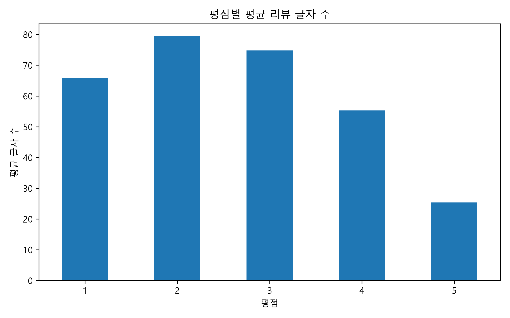
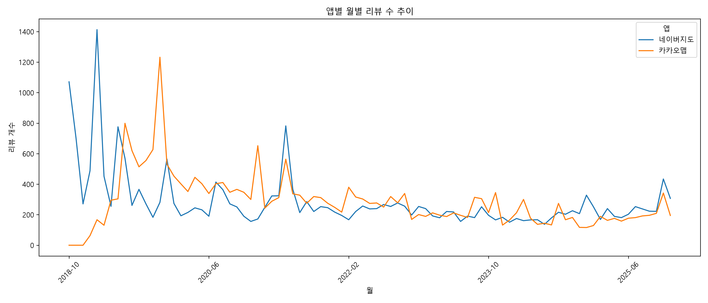
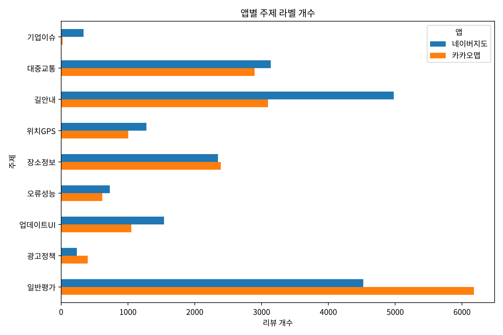
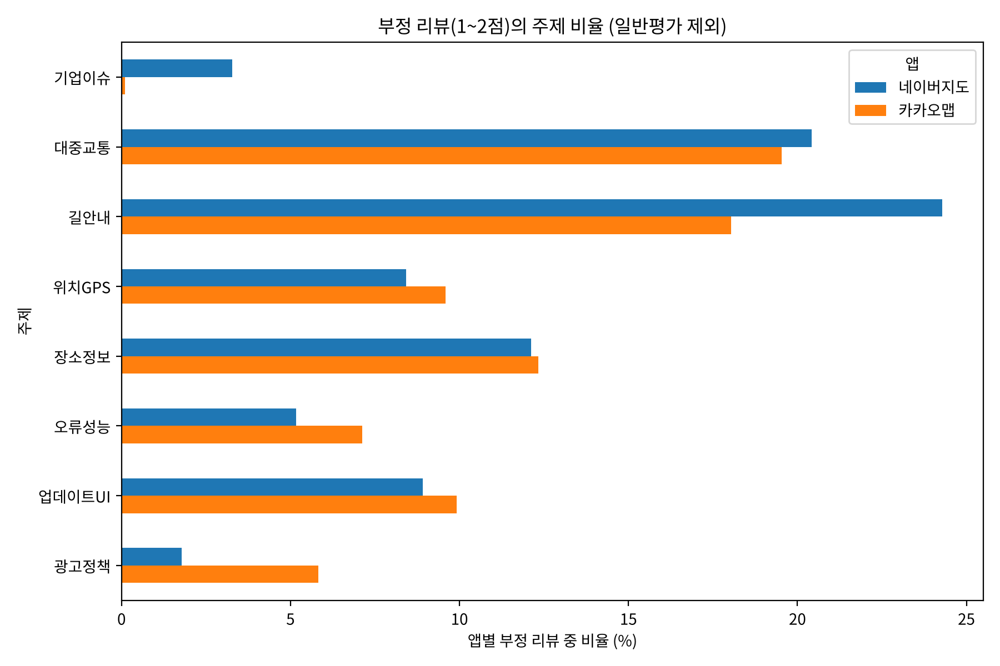
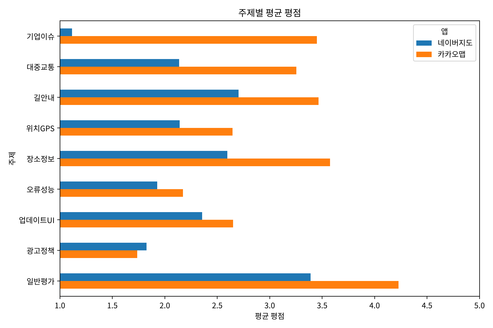

# 국내 지도 앱(카카오맵·네이버지도) 구글 플레이 리뷰 분석

## 1. 문제 정의 및 결론에 대한 가설

### 1.1 문제 정의

국내 지도·내비게이션 앱 시장은 카카오맵과 네이버지도가 양분하고 있다. 두 앱은 길찾기, 대중교통, 장소 검색 등 핵심 기능이 거의 같지만, 구글 플레이 스토어에서 수집한 리뷰의 평균 평점은 **카카오맵 3.85점, 네이버지도 3.03점으로 0.82점 차이**가 난다.

평점은 사용자의 만족도를 하나의 숫자로만 보여 주므로, 이 차이가 **어떤 기능에 대한 불만에서 비롯되었는지**는 알 수 없다. 본 분석은 리뷰 텍스트에 **감성**과 **주제** 라벨을 부여하여 다음 질문에 답하고자 한다.

> 두 지도 앱의 사용자는 각각 어떤 기능에 불만을 가지며, 그 차이가 평점 차이를 설명하는가?

### 1.2 가설

| 번호 | 가설 | 확인 방법 |
|---|---|---|
| H1 | 네이버지도는 카카오맵보다 부정 리뷰의 비율이 높을 것이다. | 앱별 감성 라벨 비율 |
| H2 | 네이버지도의 부정 리뷰는 **길안내(내비게이션)** 와 **업데이트·UI 변경**에 대한 불만의 비중이 카카오맵보다 클 것이다. | 부정 리뷰의 주제 라벨 비율 |
| H3 | **대중교통**(버스·지하철 도착 정보) 관련 불만은 두 앱 모두에서 가장 큰 불만 주제 중 하나일 것이다. | 부정 리뷰의 주제 라벨 비율 |
| H4 | 특정 시기의 평점 하락은 앱 기능이 아닌 외부 사건(기업 이슈 등)에 의해 발생할 수 있다. | 월별 리뷰 추이와 주제 라벨 |

---

## 2. 확보한 데이터의 양

| 항목 | 내용 |
|---|---|
| 수집 대상 | 카카오맵(`net.daum.android.map`), 네이버지도(`com.nhn.android.nmap`) |
| 수집 방법 | `google-play-scraper` 라이브러리, 한국 스토어·한국어 리뷰(`lang="ko", country="kr"`), 최신순 (`test1.py`) |
| 수집 기간 | 2018년 10월 ~ 2025년 12월 |
| 원본 데이터 | **50,000건** (앱별 25,000건) |
| 전처리 후 데이터 | **36,750건** (네이버지도 19,106건, 카카오맵 17,644건) |
| 수집 항목 | 앱 이름, 리뷰 ID, 평점(1~5), 작성일, 리뷰 내용, 좋아요 수, 앱 버전 |

처음에는 2024~2025년 리뷰만 사용하려 하였으나, 이 기간의 리뷰는 9,659건으로 권장 기준(전처리 후 25,000건 이상)에 미치지 못하였다. 따라서 수집 기간을 2018년부터로 넓혀 앱별 25,000건을 확보하였다.

> 원본 파일명(`map_app_reviews_2024_2025_50000.csv`)에는 2024_2025가 남아 있으나, 실제 데이터 기간은 위 표와 같다.

### 2.1 전처리

| 단계 | 기준 | 남은 리뷰 수 |
|---|---|---|
| 원본 | - | 50,000 |
| 중복 제거 | `review_id` 기준 | 50,000 |
| 언어 필터 | 글자 중 한글 비율 50% 이상 (영어만·이모지만 있는 리뷰 제외) | 49,321 |
| 길이 필터 | 공백 정리 후 10글자 이상 ("좋아요", "굿" 등 주제를 판단할 수 없는 리뷰 제외) | **36,750** |

---

## 3. 원본 데이터 EDA

원본 50,000건에 대한 탐색적 분석은 `test.py`로 수행하였으며, 그래프 13개는 `eda_results/` 폴더에 있다.

### 3.1 기본 통계

| 앱 | 리뷰 수 | 평균 평점 | 평균 리뷰 길이 | 리뷰 길이 중앙값 | 평균 좋아요 수 |
|---|---|---|---|---|---|
| 네이버지도 | 25,000 | **3.03** | 55.3자 | 33자 | 2.97 |
| 카카오맵 | 25,000 | **3.85** | 39.2자 | 19자 | 2.36 |

- 결측치는 `app_version` 4,579건(앱 버전 정보가 없는 리뷰)뿐이며, 분석에 쓰는 평점과 리뷰 내용에는 결측이 없다.

### 3.2 평점 분포

| 앱 | 1점 | 2점 | 3점 | 4점 | 5점 |
|---|---|---|---|---|---|
| 네이버지도 | 35.6% | 7.2% | 10.6% | 11.7% | 34.9% |
| 카카오맵 | 19.4% | 4.2% | 6.6% | 11.4% | 58.5% |


- 두 앱 모두 1점과 5점에 몰린 **양극화(J자형) 분포**를 보인다. 앱 리뷰는 매우 만족하거나 매우 불만족한 사용자가 주로 작성하기 때문이다.
- 네이버지도는 1점 비율(35.6%)이 5점 비율(34.9%)보다 높고, 카카오맵은 5점이 절반 이상(58.5%)이다.

### 3.3 리뷰 길이

| 평점 | 1점 | 2점 | 3점 | 4점 | 5점 |
|---|---|---|---|---|---|
| 평균 리뷰 길이 | 65.7자 | 79.5자 | 74.7자 | 55.3자 | 25.4자 |



- 5점 리뷰는 평균 25자로 짧고("좋아요", "잘 쓰고 있어요"), 1~3점 리뷰는 65~80자로 구체적인 불만을 길게 서술한다.
- 즉 **기능별 불만을 파악하는 데 필요한 정보는 대부분 낮은 평점의 리뷰에 들어 있다.** 본 분석에서 부정 리뷰의 주제 분석에 초점을 맞춘 이유이다.

### 3.4 시기별 리뷰 추이



- 2019년에 리뷰가 가장 많고(앱별 약 5,800건), 2020년 이후는 앱별 연간 2,100~4,600건 수준이다.
- 네이버지도는 **2021년 5월에 리뷰가 782건으로, 월 중앙값(238건)의 약 3배로 급증**하였다. 5절의 주제 라벨링 결과, 이 시기 리뷰는 앱 기능이 아니라 회사 직원의 직장 내 괴롭힘 사건에 대한 항의(불매) 리뷰가 대부분이었다(가설 H4).

---

## 4. 데이터 라벨링의 정의

리뷰마다 두 종류의 라벨을 부여한다.

### 4.1 라벨 1: 감성 (`sentiment`)

| 라벨 | 정의 |
|---|---|
| 긍정 | 평점 4~5점 |
| 중립 | 평점 3점 |
| 부정 | 평점 1~2점 |

리뷰 작성자가 직접 매긴 평점은 그 리뷰에 대한 작성자 본인의 평가이므로, 대량의 리뷰에 감성 라벨을 부여하는 신뢰할 수 있는 기준(약한 지도, weak supervision)으로 사용하였다.

### 4.2 라벨 2: 주제 (`topic`)

리뷰가 **앱의 어떤 기능이나 측면에 대해 말하는지**를 나타내는 라벨이다. 리뷰 하나에 여러 주제가 나올 수 있으므로, 가장 중심이 되는 주제 하나를 대표 주제(`topic`)로, 언급된 주제 전체를 보조 정보(`topic_all`)로 저장한다.

| 주제 | 정의 | 예시 리뷰 |
|---|---|---|
| 대중교통 | 버스·지하철 도착 정보, 노선, 환승, 승하차 알림 | "버스 시간 하나도 안 맞음" |
| 길안내 | 자동차·도보·자전거 경로 안내와 내비게이션 기능 | "멀쩡한 길 두고 이상한 길로 안내함" |
| 위치GPS | 현재 위치, GPS 수신, 방향 인식 | "터널에서 GPS가 끊어져요" |
| 장소정보 | 장소 검색, 가게 정보, 즐겨찾기, 로드뷰, 지도 데이터 갱신 | "폐업한 식당이 아직도 나와요" |
| 오류성능 | 앱 꺼짐, 먹통, 느림, 네트워크 오류 등 앱 자체의 문제 | "앱이 계속 강제 종료됨" |
| 업데이트UI | 업데이트 후 바뀐 화면·디자인·조작 방식 | "업데이트 이후 너무 불편해졌어요" |
| 광고정책 | 광고, 로그인, 개인정보, 권한 요구 | "앱 실행할 때마다 광고가 떠요" |
| 기업이슈 | 앱 기능과 무관한 회사 관련 사건에 대한 의견 | "삼가 고인의 명복을 빕니다" |
| 일반평가 | 특정 기능 언급 없이 전반적인 만족·불만만 표현 | "잘 쓰고 있습니다", "최고에요" |

주제는 3절의 EDA에서 부정 리뷰에 자주 등장한 단어(버스, 업데이트, 길찾기, 지하철, 위치, 오류, 즐겨찾기 등)와 지도 앱의 기능 구성을 바탕으로 정하였다.

---

## 5. 데이터 라벨링 수행 과정

```
원본 50,000건 ─▶ 전처리 ─▶ 감성 라벨(평점 규칙) ─▶ 주제 라벨(키워드 사전)
                            36,750건                 │
                                                     ▼
                             개발용 300건 사람 검수 ─▶ 사전 보완(1차 → 최종)
                                                     │
                                                     ▼
                             평가용 200건 사람 검수 ─▶ 최종 정확도 측정
```

### 5.1 감성 라벨링

4.1절의 규칙에 따라 평점을 감성 라벨로 바꾸었다(`labeling.py`).

### 5.2 주제 라벨링: 키워드 사전 방식

1. **키워드 사전 구성**: 주제마다 그 주제를 나타내는 단어 목록을 만들었다. 예를 들어 대중교통은 "버스", "지하철", "정류장", "환승", "승하차" 등이다.
2. **점수 계산**: 리뷰를 소문자로 바꾼 뒤, 주제별로 키워드가 몇 번 나오는지 센다. "대중교통", "GPS", "광고"처럼 주제가 분명한 단어는 3점, 나머지 단어는 1점으로 계산한다.
3. **대표 주제 결정**: 점수가 가장 높은 주제를 대표 주제로 정한다. 점수가 같으면 사전의 앞쪽 주제를 우선하고, 키워드가 하나도 없으면 "일반평가"로 분류한다.

### 5.3 사람 검수를 통한 라벨 품질 확인

규칙 기반 라벨이 실제로 맞는지 확인하기 위해, 리뷰를 직접 읽고 정답 주제를 붙인 검수 데이터를 두 번 만들었다(`label_check.py`).

**(1) 개발용 검수 (300건, 앱별 150건 무작위 추출)**

1차 키워드 사전으로 라벨링한 결과를 사람이 읽은 정답과 비교하였을 때 **정확도는 82.0%** 였다. 틀린 사례를 분석하여 다음과 같이 사전을 보완하였다.

| 오분류 유형 | 예시 | 보완 내용 |
|---|---|---|
| 키워드가 없어 일반평가로 분류 | "터널에서 전혀 못 잡네" | 위치GPS에 "터널", "지피에스" 추가 |
| 다른 뜻으로 쓰인 단어 | "승차 **알림**" → 광고정책, "**카카오톡**이 낫다" → 광고정책 | 광고정책에서 "알림", "카카오톡" 제거, 대중교통에 "승하차" 추가 |
| 단어 일부가 겹침 | "전**기차** 충전소" → 대중교통(기차) | "기차" 제거 |
| 지도 데이터 갱신을 앱 업데이트로 분류 | "**지도 업데이트** 좀 해주세요" | 장소정보에 "지도 업데이트"를 강한 키워드로 추가 |
| 회사 이슈 표현 누락 | "사람 죽여 놓고 서비스가 잘 되길 바람?" | 기업이슈에 "죽여", "죽음" 추가 |

보완 후 같은 300건의 정확도는 **92.7%** 로 올랐다. 다만 이 수치는 사전을 고칠 때 참고한 데이터로 잰 것이므로 실제 성능보다 높게 나온다.

**(2) 평가용 검수 (200건, 앱별 100건, 개발용과 겹치지 않음)**

사전 보완을 마친 뒤 새로 뽑은 200건을 **규칙의 결과를 보지 않은 상태에서** 직접 라벨링하고, 그다음에 규칙 라벨과 비교하였다. 이 200건에는 감성 정답도 함께 붙였다.

| 항목 | 정확도 |
|---|---|
| 주제 라벨 (키워드 사전) | **71.0%** (네이버지도 72.0%, 카카오맵 70.0%) |
| 감성 라벨 (평점 기반, 3분류) | 74.5% |
| 감성 라벨 (긍정·부정만) | **88.5%** |

- **주제 라벨**: 개발용(92.7%)과 평가용(71.0%)의 차이는 키워드 사전이 개발용 데이터의 표현에 맞춰졌기 때문이다(과적합). 주로 "길도 잘 찾아서 좋아요"처럼 키워드 없이 기능을 설명하는 짧은 리뷰가 일반평가로 분류되거나, "업데이트 이후 앱이 멈춤"처럼 여러 주제가 섞인 리뷰에서 대표 주제를 다르게 고르는 경우였다(`dataset/label_test_errors.csv`).
- **감성 라벨**: 부정 리뷰를 긍정으로 잘못 분류한 경우는 거의 없었다. 중립 정확도가 낮은 이유는 "다크모드 부탁드려요"처럼 **기능을 요청하면서 5점을 준 리뷰**가 많기 때문이다. 긍정과 부정만 놓고 보면 88.5%가 일치하여, 평점을 감성 라벨로 쓰는 것은 타당하다고 판단하였다.

---

## 6. 라벨링 결과: 학습 데이터셋 구축

### 6.1 데이터셋 구성

| 파일 | 건수 | 내용 |
|---|---|---|
| `dataset/labeled_reviews.csv` | **36,750** | 전처리한 전체 리뷰 + 감성·주제 라벨 (학습 데이터셋) |
| `dataset/label_dev_gold.csv` | 300 | 사람이 직접 붙인 주제 정답 (개발용) |
| `dataset/label_test_gold.csv` | 200 | 사람이 직접 붙인 주제·감성 정답 (평가용) |
| `dataset/labeling_summary.csv` | - | 앱별 라벨 분포 요약 |

`labeled_reviews.csv`의 열 구성은 다음과 같다.

| 열 | 설명 |
|---|---|
| `app_name`, `review_id`, `review_date`, `rating`, `review_text` | 원본 정보 |
| `review_length`, `thumbs_up_count`, `app_version` | 리뷰 길이, 좋아요 수, 앱 버전 |
| `sentiment` | 감성 라벨 (긍정·중립·부정) |
| `topic` | 대표 주제 라벨 (9개 중 1개) |
| `topic_all` | 언급된 모든 주제 (`|`로 구분) |

### 6.2 라벨 분포

**감성 라벨**

| 앱 | 긍정 | 중립 | 부정 |
|---|---|---|---|
| 네이버지도 | 6,680 (35.0%) | 2,445 (12.8%) | **9,981 (52.2%)** |
| 카카오맵 | 10,702 (60.7%) | 1,514 (8.6%) | 5,428 (30.8%) |


**주제 라벨**

| 주제 | 네이버지도 | 카카오맵 | 합계 |
|---|---|---|---|
| 길안내 | 4,978 | 3,094 | 8,072 |
| 대중교통 | 3,139 | 2,894 | 6,033 |
| 장소정보 | 2,348 | 2,391 | 4,739 |
| 업데이트UI | 1,540 | 1,049 | 2,589 |
| 위치GPS | 1,277 | 1,005 | 2,282 |
| 오류성능 | 728 | 614 | 1,342 |
| 광고정책 | 236 | 398 | 634 |
| 기업이슈 | 337 | 20 | 357 |
| 일반평가 | 4,523 | 6,179 | 10,702 |
| **합계** | **19,106** | **17,644** | **36,750** |



- 특정 기능을 언급한 리뷰는 26,048건(70.9%)이다.
- 리뷰 하나에 두 개 이상의 주제가 나온 경우는 11,338건(30.9%)이다.

---

## 7. 라벨링 결과로 본 가설 확인

### 7.1 부정 리뷰의 주제 비율

| 주제 | 네이버지도 | 카카오맵 |
|---|---|---|
| 길안내 | **24.3%** | 18.0% |
| 대중교통 | **20.4%** | **19.5%** |
| 장소정보 | 12.1% | 12.3% |
| 업데이트UI | 8.9% | 9.9% |
| 위치GPS | 8.4% | 9.6% |
| 오류성능 | 5.2% | 7.1% |
| 광고정책 | 1.8% | 5.8% |
| 기업이슈 | 3.3% | 0.1% |
| 일반평가 | 15.6% | 17.6% |





### 7.2 가설별 결과

| 가설 | 결과 | 근거 |
|---|---|---|
| H1 부정 리뷰 비율 | **지지** | 부정 리뷰 비율이 네이버지도 52.2%, 카카오맵 30.8%로 21.4%p 차이 |
| H2 길안내·업데이트UI 불만 | **부분 지지** | 길안내는 네이버지도(24.3%)가 카카오맵(18.0%)보다 6.3%p 높음. 업데이트UI는 오히려 카카오맵(9.9%)이 조금 더 높음 |
| H3 대중교통 공통 불만 | **지지** | 두 앱 모두 부정 리뷰의 약 20%로 가장 큰 불만 주제 중 하나 |
| H4 외부 사건의 영향 | **지지** | 네이버지도 기업이슈 리뷰 337건 중 281건이 2021년 5월에 집중, 평균 평점 1.12점 |

- 같은 주제라도 네이버지도의 평균 평점이 모든 주제에서 낮았다. 특히 **대중교통(2.14점 vs 3.25점)과 길안내(2.70점 vs 3.47점)** 에서 차이가 컸다. 두 앱의 평점 차이는 이용자가 가장 많이 쓰는 길찾기와 대중교통 기능의 만족도 차이에서 주로 나온 것으로 해석된다.
- 카카오맵은 광고정책 불만(5.8%)이 네이버지도(1.8%)보다 많았다. 해당 리뷰 316건 중 "개인정보"를 언급한 리뷰가 185건으로 가장 많았고, "광고"(76건), "로그인"(39건)이 뒤를 이었다.

### 7.3 한계

- 주제 라벨의 평가용 정확도는 71.0%이므로, 7절의 비율은 경향을 보는 용도로 해석해야 한다. 앱 간 비교는 두 앱에 같은 규칙을 적용하였고 앱별 정확도도 비슷하므로(72.0%, 70.0%) 상대적인 차이는 의미가 있다.
- 사람이 직접 붙인 정답 500건(개발용 300건 + 평가용 200건)을 학습 데이터로 하여 텍스트 분류 모델(예: TF-IDF + 로지스틱 회귀, KoBERT/KoELECTRA)을 학습하면 키워드 사전보다 정확한 주제 라벨을 얻을 수 있을 것이다.
- 수집 기간이 2018~2025년으로 길어, 앱이 크게 바뀐 시점 전후의 리뷰가 섞여 있다.

---

## 8. 소스코드 구성 및 실행 방법

| 파일 | 내용 |
|---|---|
| `test1.py` | 구글 플레이 리뷰 수집 (앱별 25,000건) → `map_app_reviews_2024_2025_50000.csv` |
| `test.py` | 원본 데이터 EDA → `eda_results/` 그래프 13개, `앱별_통계요약.csv` |
| `labeling.py` | 전처리, 감성·주제 라벨링, 라벨 분포 그래프 → `dataset/labeled_reviews.csv`, `labeling_results/` |
| `label_check.py` | 사람 검수 정답과 규칙 라벨 비교, 정확도 계산 → `dataset/label_test_errors.csv` |

실행 환경: Python 3, `pandas`, `matplotlib`, `google-play-scraper`

```bash
pip install pandas matplotlib google-play-scraper
python test1.py         # 1. 리뷰 수집
python test.py          # 2. 원본 데이터 EDA
python labeling.py      # 3. 전처리 + 라벨링 → 학습 데이터셋
python label_check.py   # 4. 라벨 검수 결과 확인
```
